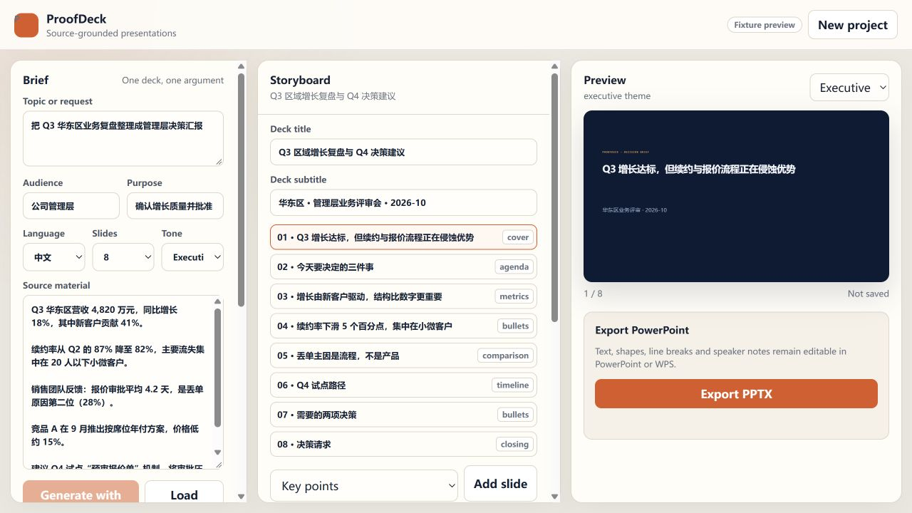
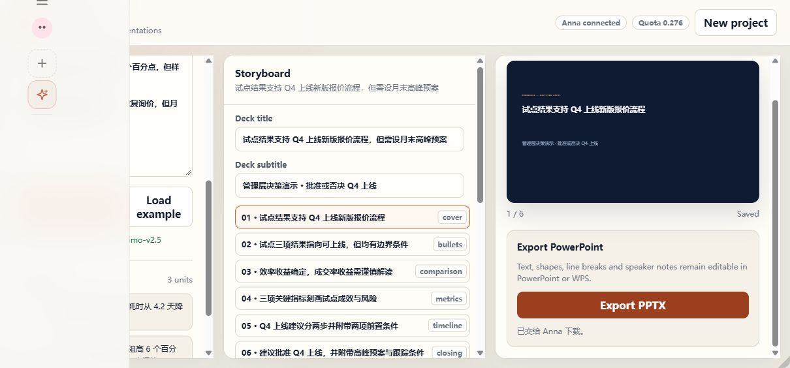

<p align="left">
  
</p>

# ProofDeck

ProofDeck turns meeting notes, reports, and research notes into a decision-ready presentation that can be edited and exported as a real `.pptx` file.





The product is deliberately focused. It does not try to be a template marketplace or a freeform slide canvas. It takes source material, creates a claim sequence, keeps factual claims traceable to `S1`, `S2`, and similar source IDs, and puts the result into an editable deck.

## What users can do

- Enter a topic, audience, purpose, language, slide count, and tone.
- Paste source material that is automatically split into numbered units.
- Generate a complete 6 to 10 slide deck with one `anna.llm.complete` call.
- Review and edit titles, key points, metrics, comparisons, timelines, and speaker notes.
- Add, remove, reorder, and re-layout slides without spending model quota.
- Switch among Executive, Minimal, and Signal themes.
- Export a real 16:9 PowerPoint file with editable text, shapes, and notes.
- Keep the current draft in Anna storage and restore it after reopening the App.

The included demo uses a Q3 business review so reviewers can test editing and export immediately without calling a model.

## Anna integration

ProofDeck is a schema 4 static SPA with no custom Executa backend.

| Capability | Anna API | Purpose |
| --- | --- | --- |
| AI planning | `anna.llm.complete` | Generate the full deck as strict JSON in one bounded call |
| Draft persistence | `anna.storage.get/set` | Restore the latest project |
| PPTX storage | `anna.files.upload_init`, R2 PUT, `anna.files.upload_finalize` | Persist the generated file |
| User download | `anna.files.download` | Host-mediated browser save |
| Entry context | Anna `entry_payload` | Receive topic and source material from chat |

The model returns content and layout intent only. The App owns coordinates, typography, overflow handling, and PowerPoint structure. Model output is normalized into a small schema, with only plain text values rendered through DOM APIs and PPTXGenJS. Model-provided HTML and coordinates are never executed.

Anna controls the final model route. The App can send optional model preferences, but an account-level default can override them. ProofDeck always displays the model that actually ran and warns when the requested model family differs from the returned model.

### Quota discipline

- One normal generation call creates the complete deck.
- The output cap scales from 2,800 to 5,600 tokens with deck length and `temperature: 0.5`. The App leaves reasoning control to Anna so models with mandatory reasoning remain usable.
- Editing, reordering, theme changes, preview, and export do not call an LLM.
- A failed or malformed response is surfaced to the user without a normal paid retry. The only retry is a narrow compatibility retry when a provider rejects the initial request because reasoning is mandatory.
- The App displays the actual model name and `_meta.quotaConsumed` when Anna returns it.

## Run locally

Requirements: Node.js 22+, npm, and the Anna App CLI.

```bash
npm ci
npm run dev:mock
```

Open the Harness URL printed by the CLI. The mock fixture exercises the same generation parser used in production without consuming quota.

Useful modes:

```bash
npm run dev        # UI only; LLM calls are disabled
npm run dev:mock   # deterministic local AI response
npm run dev:real   # real Anna model calls after `anna-app login`
```

For a standalone UI check without the Anna SDK:

```bash
npm run build
python -m http.server 8081 --directory dist
```

## Tests

```bash
npm test
npm run smoke
npm run validate
```

The test suite covers source numbering, schema normalization, invalid source references, request bounds, reply truncation, one-call generation, entry payload preservation, export fallback behavior, and deck packaging. The smoke test opens the PPTX as a ZIP and verifies:

- Eight slides and eight speaker-note pages
- A valid 16:9 presentation canvas
- Editable PowerPoint shape XML
- Slide content and source footer text

The generated smoke-test deck also opens in Microsoft PowerPoint and exports all eight slides as 1280x720 images.

Real acceptance runs covered four model families:

| Model | Case | Result | Quota |
| --- | --- | --- | --- |
| `xiaomi/mimo-v2.5` | Chinese business, roadmap, and strategy decks; 6/8/10 pages | All passed; PPTX and notes validated | 0.27–0.36 CU per run |
| `anthropic/claude-sonnet-4.5` | Eight-page English financial analysis | Passed; 8 slides and 8 notes | 24.579 CU |
| `google/gemini-3.5-flash` | Eight-page clinical-evidence seminar | Passed after increasing the output cap; caveats retained | 28.301 CU |
| `qwen3.8-flash` | Six-page Chinese project-risk report | Passed; 6 slides from 5 sources | 0.543 CU |
| `xiaomi/mimo-v2.5` | Six-page training deck with no source material | Passed; no fabricated source references | 0.233 CU |

GPT-5 Mini, Kimi K2.5, and MiniMax M2.7 exposed mandatory-reasoning errors. The App now retries those narrowly with minimal reasoning. Their staging gateway was returning HTTP 502 during this test window, so those paths are documented as provider-unavailable rather than reported as successful runs.

Total real-model testing consumed about 82.18 CU. The model returned one fewer slide than requested in one early English run. The App now preserves that valid content, inserts a visible page-count warning, and lets the user add the missing page instead of discarding a paid response.

[Download the generated ten-slide Q3 sample](examples/proofdeck-q3-sample.pptx).

Full cross-model and PPTX validation details are in [docs/validation.md](docs/validation.md).

## Project structure

```text
bundle/
  app.js          editor workflow and Anna lifecycle
  ai.js           prompt, one-call generation, validation
  export.js       PptxGenJS and Anna file storage
  fixture.js      offline demo data
  layout.js       shared preview and PPTX geometry
  model.js        deck schema and normalization
  preview.js      local slide renderer
fixtures/
  llm-deck.jsonl  deterministic local LLM response
scripts/
  smoke-export.mjs
tests/
```

## Publishing

The App metadata is in `app.json`; runtime and window metadata are in `manifest.json`.

```bash
npx anna-app validate --strict
npx anna-app apps push
npx anna-app apps publish
```

Publishing requires a verified Anna developer account and an available immutable slug. The public identity is `@liuzk2025/proofdeck-ai`.

## Current limitations

- The v1 flow produces structured text and native shapes, not AI-generated photography or illustrations.
- PDF and DOCX upload are not included. Users can paste extracted text.
- The desktop layout is the primary target. The declared minimum size is 720x520.
- A production download requires Anna's file bridge. The local Harness can build and validate the file, but its mocked file endpoint does not expose the production save dialog.

## Privacy and trust

Source content is sent only through the installed App's Anna model call. No API keys, model credentials, or source files are committed to this repository. Source text is explicitly treated as untrusted data in the model prompt. Citations are validated against the source units created by the App, and nonexistent references are removed before rendering.

## License

MIT. PPTXGenJS is vendored with its upstream license in `bundle/vendor/pptxgenjs-LICENSE`.
