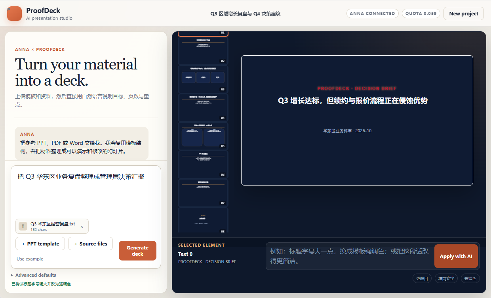
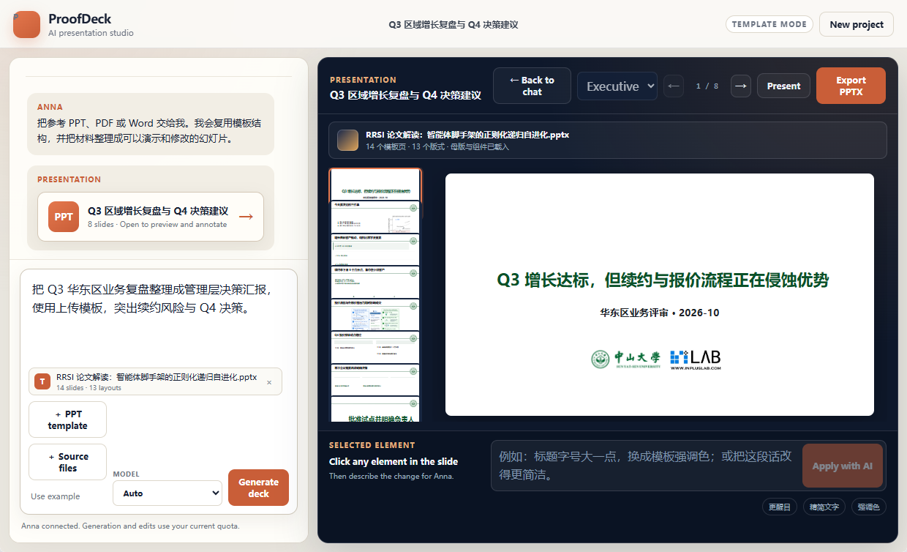

<p align="left">
  
</p>

# ProofDeck

ProofDeck is an Anna App that turns a short brief, source documents, and an optional PowerPoint template into an editable presentation. The first screen is a clean chat with one model selector. Attach material, describe the deck, and generate. A presentation link appears in the conversation only after the deck is ready; opening that link enters the split preview and annotation workspace.






## Product idea

Most AI presentation tools produce attractive slides but discard the organization's existing brand system. ProofDeck keeps the template as the visual source of truth. It copies real template slides instead of approximating their colors with a new deck builder, so masters, layouts, theme fonts, background artwork, logos, footers, and fixed shapes remain inside the PowerPoint package.

The product is intentionally narrow:

- Input: one prompt, optional `.pptx` template, and PDF, DOCX, TXT, or Markdown sources.
- Generation: one structured Anna model call for the complete content plan.
- Output: an editable `.pptx` file plus an in-app SVG preview.
- Revision: select one shape, describe the change, and let Anna return a bounded JSON patch for that shape only.

## What users can do

- Upload a `.pptx` template and inspect its slide count, layouts, masters, fonts, and components.
- Upload PDF, DOCX, TXT, and Markdown source files or paste requirements in the prompt.
- Choose the preferred Anna model directly in the composer. Language, slide count, tone, layout, and writing goals stay in the natural-language prompt.
- Generate 6, 8, or 10 presentation slides in one Anna `llm.complete` request.
- Preserve source references such as `S1` and `S2`; invalid model-created references are removed.
- Browse all generated slides in a filmstrip or full-screen presentation mode.
- Click a title, text block, or supported shape to select it.
- Ask for text replacement, font size, color, font family, bold, italic, underline, movement, resize, or fill changes.
- Export the modified deck as a real PowerPoint file.
- Restore the current draft from IndexedDB and Anna storage.

## Interaction flow

1. The App opens as a single, full-width conversation. No empty slide canvas or disabled preview is shown.
2. Template and source files appear as compact attachments inside the composer.
3. After successful generation, Anna replies with a clickable presentation card showing the deck title and slide count.
4. Opening the card reveals the existing left-chat/right-presentation workspace.
5. A back button returns to the conversation without discarding the deck.

## Template reuse

The browser-side OfficeKit engine performs the template-faithful workflow:

1. Load the uploaded `.pptx` into its existing package.
2. Read the real slides, masters, layouts, theme, media, and shape tree.
3. Clone a donor slide for each generated slide.
4. Fill title and content placeholders, or use detected free-form text shapes.
5. Clear stale donor body copy while retaining repeated fixed text, master elements, media, backgrounds, and non-text components.
6. Remove the original donor slides while retaining the source presentation infrastructure.
7. Save the complete package with editable PowerPoint XML and speaker notes.
8. Render each slide to SVG with shape IDs for in-app preview and selection.

The first template slide is used for the cover, the last for the closing slide, and template body slides are cycled for intermediate content. Existing visual components are duplicated intact. This supports standard PowerPoint shapes, text, images, tables, and themed backgrounds. For templates without placeholders, ProofDeck detects title/body text by position and typography, removes stale donor copy, and distributes generated content across compatible text regions.

The supplied 14-slide RRSI paper deck was used as an acceptance template. It contains 2 masters, 13 layouts, 3 themes, 15 media parts, and free-form text instead of body placeholders. The generated deck retained every theme, master, and layout part byte-for-byte, reused media from the selected donor slides, replaced all tested stale body copy, and passed OfficeKit package validation.

SmartArt, OLE objects, embedded video, and custom animation fidelity depend on the upstream OfficeKit parser and PowerPoint serialization. They should be tested with the organization's actual production templates before deployment.

## Selected-element AI edits

The preview maps each rendered SVG element to its PowerPoint shape ID. Selecting an element sends only bounded context to Anna: the current slide, selected shape, surrounding text, relevant source excerpts, and template layout names.

Anna returns JSON operations restricted to the selected `slideIndex` and `shapeId`. The client validates the patch, rejects any operation aimed at another element, applies it through OfficeKit, re-renders the deck, and updates the downloadable PowerPoint package. The model never supplies executable HTML or a new slide layout.

## Anna integration

ProofDeck is a schema 4 static SPA with no custom Executa backend.

| Capability | Anna API | Purpose |
| --- | --- | --- |
| Deck planning | `anna.llm.complete` | Generate the complete content structure in one bounded call |
| Selected-element edit | `anna.llm.complete` | Return a small JSON patch for one shape |
| Draft persistence | `anna.storage.get/set` | Restore the latest project metadata |
| PPTX delivery | `anna.files.upload_init`, R2 PUT, `anna.files.upload_finalize`, `anna.files.download` | Hand the generated file to Anna's download flow |
| Chat handoff | Anna `entry_payload` | Receive prompt and source text from an Anna conversation |

Generation and annotation requests both display the actual returned model and quota when Anna provides them. The account-level model remains authoritative; the UI model selector is a preference, not a guarantee.

## Quota discipline

- A normal deck uses one model call. Local template parsing, preview, selection, export, theme changes, and draft restore do not consume quota.
- A selected-element annotation uses one much smaller model call with a 900-token output cap.
- Malformed or unusable edits are reported without automatic paid retries.
- The only automatic retry is a narrow compatibility retry for providers that explicitly require reasoning.
- Source upload and text extraction happen locally in the browser.

The App was developed primarily without consuming model quota. Historical cross-model generation tests from the generation-only release are preserved in [docs/validation.md](docs/validation.md); template-faithful AI acceptance and the final chat-first flow are recorded for `v0.2.1`.

## Run locally

Requirements: Node.js 22+, npm, and the Anna App CLI.

```bash
npm ci
npm run build
npm run dev:mock
```

Useful local modes:

```bash
npm run dev        # local UI, no LLM
npm run dev:mock   # deterministic model responses, no quota
npm run dev:real   # real Anna models
```

For a standalone static preview:

```bash
npm run build
python -m http.server 8081 --directory dist
```

## Validation

```bash
npm test
npm run smoke
npm run validate
```

The test suite covers:

- Prompt construction, bounded output, model routing, malformed responses, truncation, quota errors, and source-reference validation.
- Selected-element patch parsing and rejection of operations targeting other slides or shapes.
- Model response routing and the mandatory-reasoning compatibility path.
- Template inspection, slide cloning, stale-copy removal, fixed-text preservation, PPTX serialization, SVG preview generation, and single-shape patches.
- The fallback PptxGenJS presentation path.
- PowerPoint ZIP structure, speaker notes, 16:9 geometry, and editable shape XML.
- Anna schema 4 strict validation.
- Chat-first startup, hidden initial viewer, deck-link reveal, model-only composer configuration, and return-to-chat behavior.

Browser acceptance also exercises template upload, PDF extraction, DOCX extraction, mock generation, shape selection, AI annotation, export, and responsive layouts. Exact results, quota usage, and known limitations are recorded in [docs/validation.md](docs/validation.md).

## Project structure

```text
bundle/
  app.js                 chat workflow, preview, selection, persistence
  ai.js                  generation prompts and bounded edit patches
  export.js              PptxGenJS fallback and Anna file delivery
  fixture.js             offline demo data
  model.js               normalized deck schema
  vendor/                browser bundles for OfficeKit, PDF.js, Mammoth
engine/
  office-engine.js       PPTX template clone, save, render, patch
  document-engine.js     PDF, DOCX, TXT, and Markdown extraction
scripts/
  build-engine.mjs       browser engine bundling
  smoke-*                package-level integration checks
tests/
  ai.test.mjs
  export.test.mjs
  model.test.mjs
  office-engine.test.mjs
```

## Privacy and trust

Source text is sent only when the user requests generation or an AI edit through the installed App's Anna runtime. No API keys or uploaded source files are committed to this repository. Source material is treated as untrusted model input, model output is constrained to a small content schema, and edits are validated against the selected shape before being applied.

Draft PPTX bytes remain in the browser's IndexedDB. Anna storage currently receives project metadata rather than the full uploaded template.

## Publishing

The public identity is `@liuzk2025/proofdeck-ai` on Anna staging.

```bash
npx anna-app validate --strict
npx anna-app apps push --bump minor
npx anna-app apps submit-review proofdeck-ai
```

## Known limitations

- The App targets PowerPoint `.pptx`; legacy `.ppt` files are not supported.
- Complex SmartArt, OLE embeds, video, and animations may not survive template cloning with full fidelity.
- PDF extraction reads selectable text; scanned image-only PDFs require OCR before upload.
- Source extraction is capped at 60,000 characters per project and each source file is capped at 15 MB.
- The desktop layout is primary; the declared minimum window is 720x520.
- Model routing, quota, and available model families are controlled by the Anna staging account.

## License

MIT. Vendored dependencies and their licenses are listed in [THIRD_PARTY_NOTICES.md](THIRD_PARTY_NOTICES.md) and included under `bundle/vendor/licenses/`.
